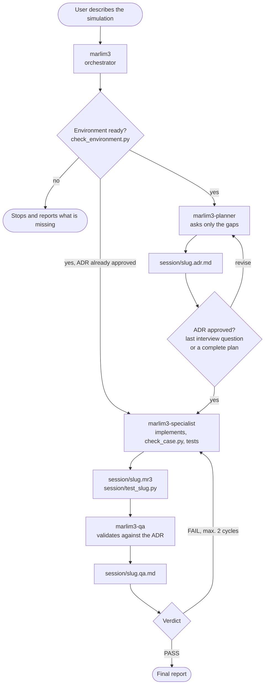
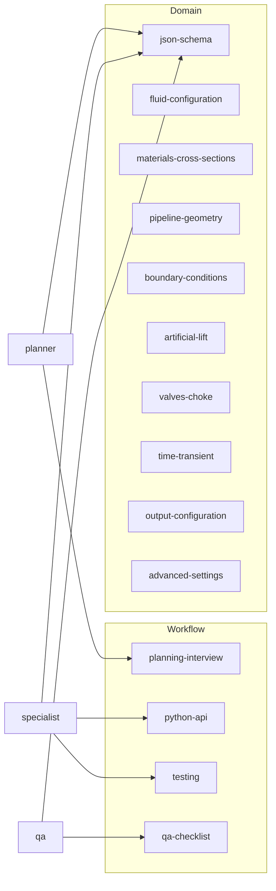

# Marlim3 agents guide

This repository includes a GitHub Copilot agent workflow for building complete Marlim3 simulations: from a natural-language request to a tested and verified `.mr3` file. You describe the simulation, the planner interviews you and records everything in an ADR, the specialist implements it and the QA validates it. Everything the agents generate stays in a git-ignored session folder.

## Workflow overview



`session` is `agent_sessions/<YYYY-MM-DD>-<slug>/` — see [Session folder](#session-folder).

## Step by step

1. Invoke the `marlim3` agent (or `marlim3-planner` directly) and describe the simulation you want: system type, fluids, geometry, transient event, etc. The `marlim3` agent first checks the environment (see [Before you start](#before-you-start)); if something is missing, it stops and tells you what and how to fix it.
2. The planner reads any documents you attach (data sheets, genkey files, …) and asks only what they don't answer, in batches (scope, fluids, geometry and thermal, boundary conditions and equipment, events and outputs). For simple or illustrative requests ("a simple case showing a lazy-wave riser") it skips the batches and uses safe defaults. If you bring a complete plan (inline or attached) that settles every engineering decision — system, fluids, geometry and walls, boundary conditions, equipment, events — it asks nothing at all. Anything you don't answer becomes a default recorded in the ADR.
3. The planner creates the session folder and writes the complete plan to `<slug>.adr.md` there, with a cross-reference table, deliverables and acceptance criteria. Its last question asks you to approve it, listing the key numbers and every assumed default — this is the only approval step. A complete plan counts as that approval: the ADR is accepted without the question, and the final report lists what was assumed.
4. The specialist reads the ADR and generates `<slug>.mr3` (English keys, with `"language": "en"`), the optional Python script and the `test_<slug>.py` suite in the same folder, following the repository conventions (`simulacao` marker, executable guard, `tmp_path`). Before delivering, it runs `check_case.py` (schema, unknown keys, cross-references, arrays and positions, all reported at once) and the tests.
5. The QA independently checks everything (ADR conformance, the automated checks, physical plausibility, test execution) and writes the final report to `<slug>.qa.md` with a PASS, PASS WITH WARNINGS or FAIL verdict.
6. On a FAIL, the orchestrator returns the findings to the specialist (at most 2 cycles) and re-runs the QA. At the end, you receive the summary with all paths and results.

## Session folder

Everything the agents generate goes to `agent_sessions/`, which is git-ignored, so nothing they produce gets committed by accident. Each pipeline run gets its own subfolder, named after the date and the case:

```text
agent_sessions/
└── 2026-10-27-lazy-wave-riser/
    ├── lazy-wave-riser.adr.md     # plan (planner)
    ├── lazy-wave-riser.mr3        # simulation input (specialist)
    ├── build_model.py             # optional build script (specialist)
    ├── test_lazy-wave-riser.py    # tests (specialist)
    └── lazy-wave-riser.qa.md      # verification report (QA)
```

To revise a case, give the `marlim3` agent (or the planner) its session folder. To keep a case in the repository, promote it to `demos/` by hand (see the last section of [marlim3-testing](skills/marlim3-testing/SKILL.md)). Input documents you don't want committed (data sheets, genkey files) can live under `agent_sessions/` too.

## Before you start

Set up the environment once, outside the agent session:

- `uv sync --locked --group dev` — the project pins uv 0.13.1 (`uv self update 0.13.1`).
- Make the simulator executable available: `uv run python -c "import marlim3"` downloads it, or build it from source (see [docs/getting-started.md](../docs/getting-started.md#building-from-source)). While it is missing, every `import marlim3` tries the download again — and, if the binary can't run on the machine, a build from source — which would stall a session.

The agents enforce this: before doing anything, they run `uv run python .github/skills/marlim3-python-api/scripts/check_environment.py`, and unless it prints `READY` they stop and report what is missing and how to fix it. You can run the same command yourself to check your setup.

## Agents

| Agent | Role | Deliverable (in the session folder) |
|--------|-------|---------|
| [marlim3](agents/marlim3.agent.md) | Orchestrates the pipeline and the correction cycle | Final report |
| [marlim3-planner](agents/marlim3-planner.agent.md) | Interviews the user, makes the engineering decisions and gets the ADR approved | `<slug>.adr.md` |
| [marlim3-specialist](agents/marlim3-specialist.agent.md) | Implements the ADR, writes the tests and runs `check_case.py` | `<slug>.mr3`, `test_<slug>.py` |
| [marlim3-qa](agents/marlim3-qa.agent.md) | Verifies and issues the verdict | `<slug>.qa.md` |

## Skills

Each agent loads only the skills relevant to the case. The workflow ones define the process; the domain ones distill the official documentation ([docs/single-branch-model-reference/](../docs/single-branch-model-reference/index.md), [docs/schemas/branch.en.json](../docs/schemas/branch.en.json)) and point to the authoritative files.



| Skill | When it is used |
|-------|----------------|
| [marlim3-planning-interview](skills/marlim3-planning-interview/SKILL.md) | Interview protocol, safe defaults and ADR template |
| [marlim3-python-api](skills/marlim3-python-api/SKILL.md) | `Branch`/`Tramo` API, `simulate()`, results and CLI |
| [marlim3-testing](skills/marlim3-testing/SKILL.md) | Repository pytest conventions and test template |
| [marlim3-qa-checklist](skills/marlim3-qa-checklist/SKILL.md) | Verification checklist and QA report template |
| [marlim3-json-schema](skills/marlim3-json-schema/SKILL.md) | `.mr3` structure, units, EN/PT keys, cross-references and the [check_case.py](skills/marlim3-json-schema/scripts/check_case.py) checker (always loaded) |
| [marlim3-fluid-configuration](skills/marlim3-fluid-configuration/SKILL.md) | Black-oil, flash table, compositional, emulsions, PVT |
| [marlim3-materials-cross-sections](skills/marlim3-materials-cross-sections/SKILL.md) | Materials, radial layers, rock formation |
| [marlim3-pipeline-geometry](skills/marlim3-pipeline-geometry/SKILL.md) | Segments, angles or XY mode, discretization, thermal coupling |
| [marlim3-boundary-conditions](skills/marlim3-boundary-conditions/SKILL.md) | IPR, sources, separator, gasInj, injector well |
| [marlim3-artificial-lift](skills/marlim3-artificial-lift/SKILL.md) | Gas lift, BCS/ESP, pumps, annulus unloading |
| [marlim3-valves-choke](skills/marlim3-valves-choke/SKILL.md) | Valves, chokes, PIG, leaks, shutdown and restart |
| [marlim3-time-transient](skills/marlim3-time-transient/SKILL.md) | Transient mode, initial condition, step schedule, snapshots |
| [marlim3-output-configuration](skills/marlim3-output-configuration/SKILL.md) | Profiles, trends, radial outputs and result DataFrames |
| [marlim3-advanced-settings](skills/marlim3-advanced-settings/SKILL.md) | Numerical tuning, performance, paraffin, 3D diffusion |

## Tips

- For a quick result, attach the documents you have or ask for defaults ("a simple case showing X, use defaults"): the planner then goes straight to the approval question. With a complete plan, it skips that question too.
- The agents ask through VS Code's question form (the `vscode/askQuestions` tool). Don't run them in Autopilot mode or with the `chat.autoReply` setting on: VS Code then answers every question by itself ("the user is not available"), so the planner gets none of your answers and the ADR stays `Proposed`.
- To only plan (without implementing), call `marlim3-planner` directly. To implement an already approved ADR, give its session folder to `marlim3`: it skips planning and goes straight to implementation and QA. To audit an existing case, call `marlim3-qa`.
- Tests with the `simulacao` marker require the compiled executable and are skipped automatically without it (see [tests/README.md](../tests/README.md)). A skipped test is not a passing test.
- Run a finished case with `uv run pytest agent_sessions/<session>/test_<slug>.py -v` or via `marlim3.Branch().from_json(...)`. Check any `.mr3` with `uv run python .github/skills/marlim3-json-schema/scripts/check_case.py <file>`.
