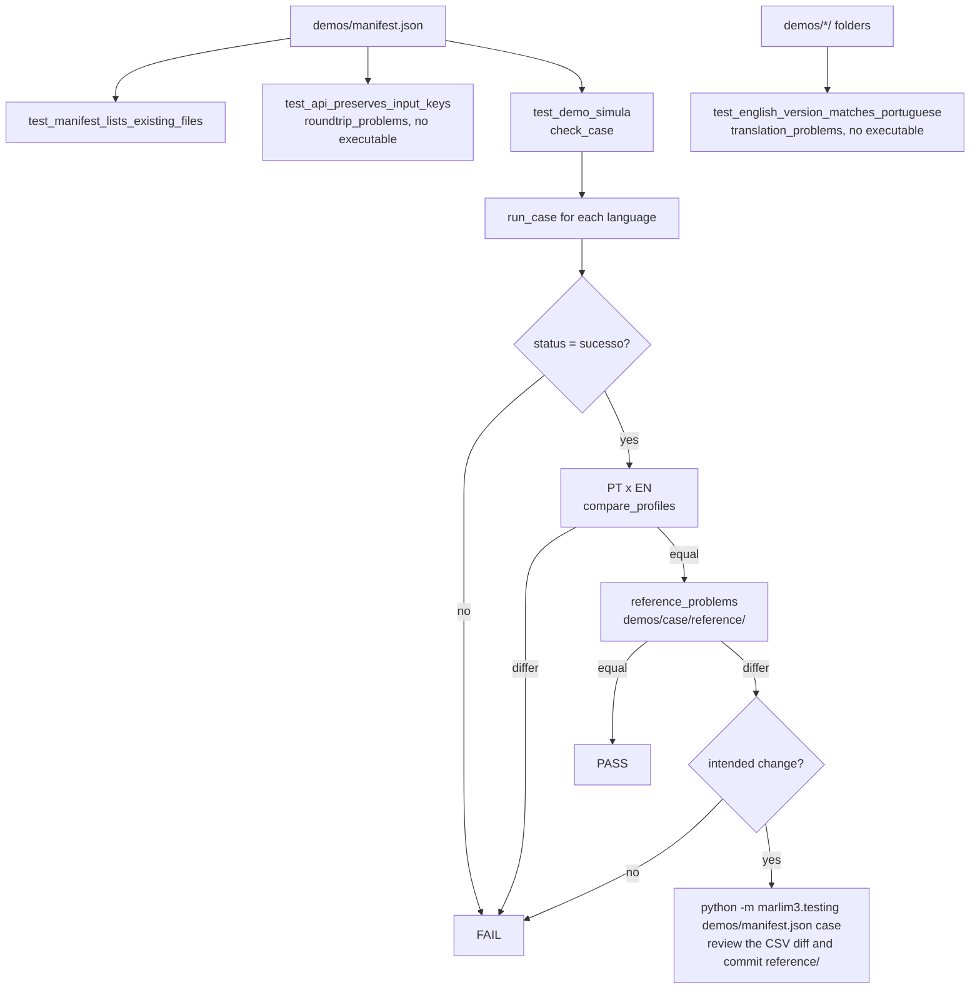

# Tests

This directory contains the test suite for `Marlim3`.

| File | Description |
|------|-------------|
| `test_marlim3.py` | Unit tests — model assembly, JSON serialization, input validation, geometry checks |
| `test_configure_simulation.py` | Integration tests — full simulation runs based on the tutorial notebook |
| `test_demos_steady_state.py` | Demo tests — API key round-trip, English version × Portuguese model (static), PT × EN runs and regression against stored references |

## Running tests

Tests marked `simulacao` require the compiled `Marlim3` executable in the `tools/marlim3/` package directory. See the root [README.md](../../README.md#compilation) for build instructions.

```bash
uv run pytest tools/tests/ -v                    # full suite
uv run pytest tools/tests/ -m "not simulacao"    # no executable required
uv run pytest tools/tests/test_demos_steady_state.py -v
```

## Demos: `demos/manifest.json`

The manifest is the only list of models used by the tests, `run_models.py --group regression`
and the regression tool. Each case has its own folder in `demos/` holding the Portuguese
model, its English version (root key `"language": "en"`) and the auxiliary files.
Only the Portuguese model is listed; the English version is found in the same folder:

```json
{"model": "simplifiedProduction/producaoSimplificado.mr3",
 "languages": ["pt", "en"],
 "aux": ["PVTSIM-MARLIM.tab"]}
```

| Field | Meaning |
|-------|---------|
| `model` | Portuguese model, relative to `demos/` |
| `languages` | languages the model is written in before running (`pt`, `en`) |
| `aux` | auxiliary files, looked up in the model folder and then in `demos/` |
| `mode` | `PRODUCAO` (default), `INJETOR` or `REDE` |
| `steady_state` | run with `transient` disabled (default `true`) |

`test_demos_steady_state.py` checks that:

1. reading and rewriting each listed model through the API loses, adds or changes no input key
   (no executable needed);
2. every demo folder, listed in the manifest or not, holds a Portuguese model and its English
   version, and the API turns both into the same engine input (no executable needed);
3. each listed model runs in every listed language;
4. the production profiles of the PT and EN runs agree;
5. the profiles and trends of the first listed language match the reference in
   `demos/<case>/reference/` (`rtol=1e-5`, `atol=1e-8`; network cases have no reference).

The manifest field `native` (3.10.1 to 3.10.3) is obsolete: it is ignored with a
`DeprecationWarning`.

The same runner (`marlim3.testing`) is used by private suites with their own manifest and
references.

### Workflow



In CI (`.github/workflows/build-test-release.yml`) each platform builds the engine first; the
test job installs that artifact into `tools/marlim3/` and runs `pytest tools/tests/`.

### How the checks work

- **`test_api_preserves_input_keys` → `roundtrip_problems`** (no executable): the model is read with
  `Branch.from_json` (or `Network.from_json` for `REDE`) and written back in Portuguese with
  `to_json`, exactly as the engine receives it. Both JSON trees are flattened into key paths
  (`/configuracaoInicial/tempo`, `/material[0]/rotulo`, ...) and compared: a key `lost`, `added` or
  `changed` is a problem. English input is translated to Portuguese before comparing; version
  keys, empty containers and top-level `*_reserva` sections are ignored.
- **`test_english_version_matches_portuguese` → `translation_problems`** (no executable): the
  Portuguese model and its English version are both read and rewritten by the API, and
  every key and value must match, except the free-text labels (`rotulo`). This is exactly what the
  engine would receive from each, so running the English version would add nothing. It catches English
  keys missing from `tools/marlim3/translations.json` (they would otherwise pass through untranslated
  and the engine would silently use defaults) and values that differ between the two files.
- **`run_case`** (one run): copies the `aux` files (model folder first, then the manifest folder)
  into `saida_testes/<case>/<language>/`, loads the model through the API, applies the `mode`
  (`INJETOR` → `-s INJETOR`, `REDE` → network run) and `steady_state` (`transient` off), writes the
  model in the requested language and runs the engine there. It returns the status from
  `simulacao.log` and the outputs used by the reference: production/service profiles and one
  trend per monitored position.
- **`compare_profiles`** (PT x EN and reference): the engine writes column headers in the
  language of the input model, so PT and EN runs have different column names. Columns are
  therefore matched **by position**: shapes must be equal, non-numeric columns are skipped and
  numeric ones must satisfy `np.allclose` (PT x EN: `rtol=1e-6`, `atol=1e-9`; reference:
  `rtol=1e-5`, `atol=1e-8`). A translation problem that changes the results (an untranslated key,
  a wrong enum value) shows up here as a numeric difference in a named column pair.

### Updating references

When a change intentionally alters simulation results, regenerate the references and commit the
CSV files in `demos/<case>/reference/`:

```bash
uv run python -m marlim3.testing demos/manifest.json                     # all cases
uv run python -m marlim3.testing demos/manifest.json simplifiedProduction/producaoSimplificado.mr3
```

> **Important:** inspect the CSV diff and make sure the changes are expected before committing.
